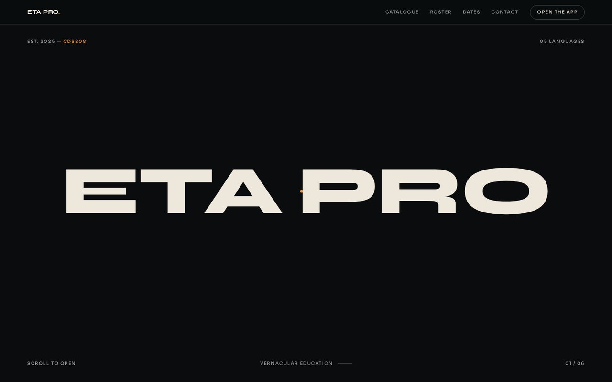
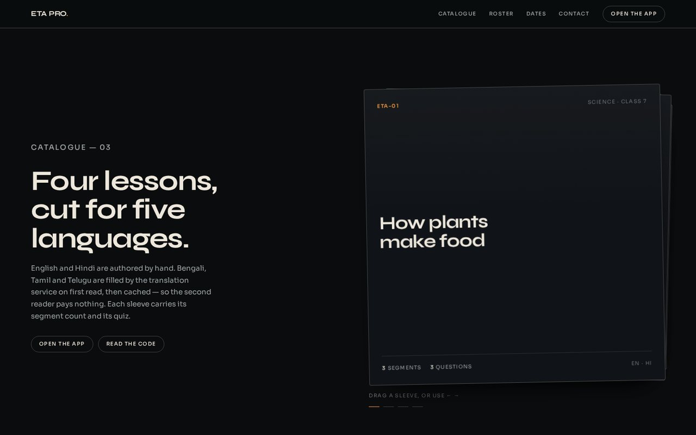

# ETA PRO — label landing page

The front page for **ETA PRO**, the vernacular education platform (CDS208 final
project), built as a record label: a portal hero that opens, a catalogue you throw
aside, a roster, and a wordmark cropped by the page edge.

Static. No framework, no build step, no dependencies beyond two Google Fonts.




## The idea

Near-black ground, warm bone ink, and **two accents pulled out of the hero
photograph** — amber from the lamp, teal from the shadow. Both stay to type, dots
and rules; neither is ever used as a filled area. No gradient banners, no bento
grids, no glows, no shadows except on the deck cards.

Type: **Syne** 600–800 for the wordmark and every heading, tight at −0.02em to
−0.03em. **Sora** 400–600 for all small type, labels uppercase at 0.12–0.15em.

```
ground  #0A0C0E   ground-2 #101317   ink #EDE7DC
ink-2   #9EA5A8   muted    #6C7378
amber   #E8913C   teal     #2E6B72   hairlines rgba(237,231,220,.13)
```

## The six sections

| # | Section | What it does |
|---|---|---|
| 01 | Portal hero | A 2.5-viewport section with a sticky, isolated stage. Two panels meet in the middle so the hero **begins closed**; the wordmark sits on top. |
| 02 | Statement fold | Full height, a 22ch statement with one phrase in amber, an outlined numeral in `-webkit-text-stroke`, and a circular image drifting off the right edge. |
| 03 | Catalogue | Two columns: headline, lede and two buttons on one side; a square deck of four sleeves on the other, with a hint line and progress dots. |
| 04 | Roster | Hairline rows: script label, the language in its own script, right-aligned counts. |
| 05 | Dates | A table of the six build phases with their real dates, collapsing to two columns per row under 640px. |
| 06 | Close | Headline, fine print, buttons at the opposite edge, a hairline footer strip, then the wordmark cropped by the page edge. |

## The three special components

**The portal title.** The wordmark is split into two spans on one line. As scroll
progress moves through the hero it scales **up** by 16% while its letter-spacing
**tightens** from −0.02em to −0.055em, and the two halves travel outward by half
their own measured width. Growing and tightening together is the whole effect — a
plain zoom reads as a zoom, this reads as a title opening.

**The portal opening.** The panels translate outward past their own width to clear
the frame, the photograph settles from an overscale of 1.08 to 1.0, the duotone
wash rises from 0 to 0.34 at `mix-blend-mode: overlay`, and the two accent dots
travel out toward opposite corners. Every value is a pure function of scroll
position, so the portal closes again on the way back up.

**The throwable deck.** Four sleeves stacked with offset, scale and rotation so the
pile reads as physical. Pointer down captures, pointer move tracks with a
translation plus rotation proportional to horizontal distance, and a release past
a tenth of the deck width throws the card out across the deck's own width before
the stack re-forms. `tabindex="0"` plus ← → handlers make it usable without a
mouse; `touch-action: pan-y` keeps vertical scrolling on a phone.

## Measured, not assumed

The hero travels, and it was measured rather than eyeballed. Headless Chromium,
1440×900, reading computed transforms at four scroll positions:

| scroll | stage top | left panel x | title scale | letter-spacing | duotone |
|---|---|---|---|---|---|
| 0 | 0 | 0.0px | 1.000 | −3.23px | 0.00 |
| 700 | 0 | −389.8px | 1.083 | −6.14px | 0.18 |
| 1600 | −250 | −751.8px | 1.160 | −8.87px | 0.34 |

`stage top 0` at scroll 700 is the sticky stage holding. The panel moves 389.8px
across the first 700px of scroll — well over the 100px the brief asks to prove.

Two bugs that measurement caught, both of which would have shipped silently:

1. `overflow-x: hidden` on `<body>` **breaks `position: sticky`** in Chromium. The
   stage was sliding away instead of pinning. Overflow is now contained at the
   source (the orbit and the close wordmark live inside `overflow: hidden`
   sections) so the body never needs it.
2. The wordmark at 13vw overflowed the frame before the halves had a chance to
   separate. It is now sized to fit the frame first and part second.

## Motion models

Everything in the portal is bound to **scroll position** and therefore reversible.
Entry reveals elsewhere fire **once** and never un-reveal. All reveal rules are
scoped to `html.js-anim`, which is only added after confirming
`prefers-reduced-motion` is not set — so the reduced-motion and no-JS renders are
the finished page, not a blank one.

## Run it

```bash
python -m http.server 5500     # open http://127.0.0.1:5500
```

Or open `index.html` directly. Deploy anywhere static — Netlify, Vercel, GitHub
Pages; every path is relative.

## Evidence rules

Every claim on the page comes from the project's own catalogue: four lessons with
their real segment and question counts, five languages, seventeen glossary terms,
and the six build phases with the dates they actually shipped. There are no press
quotes, chart positions, streaming counts or award badges, because none of those
exist.

## Structure

```
index.html              six sections, no build step
assets/css/style.css    the whole design system, ~520 lines
assets/js/label.js      portal engine, orbit, deck, reveals
assets/img/hero.jpg     the photograph the palette was taken from
docs/*.jpg              page screenshots for this README
```

The Figma exploration that preceded this build is at
[ETA Pro — Landing Page](https://www.figma.com/design/OBglATme0J94EF6MP62Uw4); the
page is the source of truth and the earlier violet exploration has been removed.
